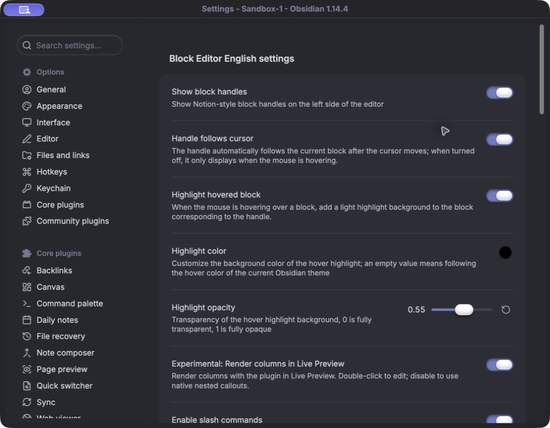
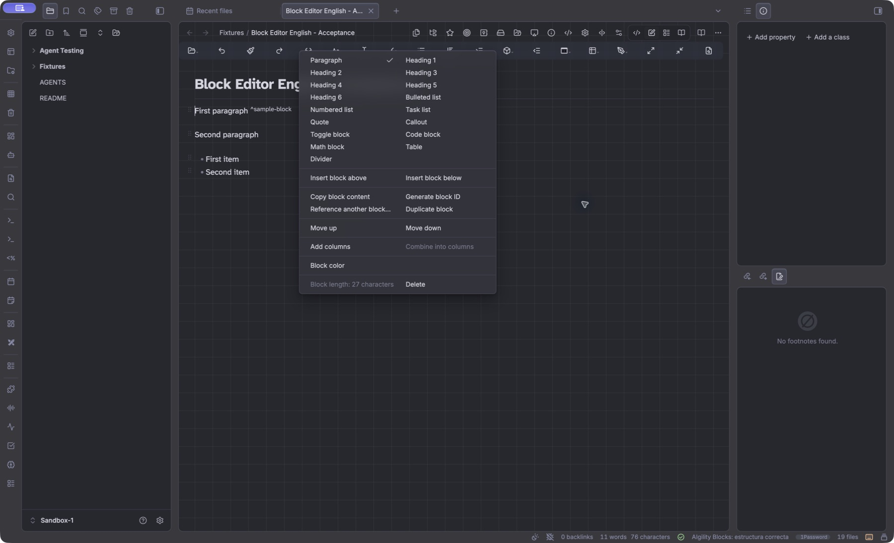

# Fork provenance and verification

- Date: 2026-10-14 (Europe/Madrid).
- Actor: Codex, at Eme's explicit request to inspect, create and install an English fork, then remove the original installed plugin.
- Original repository: [MarcBolo/block-editor](https://github.com/MarcBolo/block-editor).
- Exact starting commit: `43f80c0d9bf98659a48e37878799283975ac75f1`.
- Original release: `0.8.0`.
- Original author: MarcBolo; license copyright holder: Marco Bolo.
- License: MIT, preserved verbatim in `LICENSE`.
- Fork: [DelaCruz87/block-editor-english](https://github.com/DelaCruz87/block-editor-english).
- Fork ID: `block-editor-english`; release: `0.8.0-en.1`.

## Relationship

This is an independent language fork with retained upstream history and an `upstream` remote. A same-ID patch was rejected because community updates could overwrite the English build. Absorbing selected mechanisms into AIgility Blocks was outside this request. Automatic continuous upstream tracking was not assumed: source-wide translation requires reviewing subsequent upstream changes before merging them.

## Inspection

The plugin registers editor extensions, block handles, drag controllers, slash suggestions, commands, a Settings tab, Markdown postprocessors, colors, columns and internal-link handling. Source operations use Obsidian editors/vault files; no network request function was found in the TypeScript source. The donation QR images belong to the original author and remain attributed to that author.

The installed ENSO original was version 0.8.0. The initial live read showed it installed but neither enabled nor loaded. Its settings were read separately from runtime state.

Block identities, note contents, settings keys, command suffixes, Markdown syntax, CSS selectors and callout metadata are preserved. Only the fork's plugin ID/package identity changes. Generated table headings and weekday names are English. Internal debug object keys with Chinese identifiers are renamed to English; they are not persisted settings or note metadata.

## Translation and retained material

UI strings and parameterized messages were externalized mechanically before translation. The table contains 361 entries. English text was then reviewed for consistent Obsidian terminology and parameter preservation. Comments in TypeScript, CSS, scripts and historical source backups were translated. English docs describe all feature groups, settings, build steps and compatibility limits.

International test documents remain fixture data with Unicode escapes; replacing those contents would change parser offsets and weaken multilingual regression coverage. Test names and diagnostic prose are English. The legacy parity snapshot is marked historical and is not current acceptance evidence. Source backup files ending in `.bak-colbg` are historical upstream material, translated for readability and excluded from compilation. Original screenshots are historical upstream assets; they do not prove the current English UI.

## Inherited issues and scoped repairs

- Ordinary dependency installation fails because upstream's CodeMirror declarations conflict with Obsidian's exact peer versions. The fork records the required npm resolution mode and pins dependency versions.
- Upstream compilation passed with that resolution mode. Nine executable regression groups passed before translation.
- Upstream `npm test` fails because `scripts/legacy-main.cjs` is absent. The fork exposes that harness as `test:legacy-parity` and uses the executable regression groups as its default test suite.
- A source guard used a fixed 700-character slice, which stopped covering its target when comments became longer in English. It now checks the same executable branch while ignoring comment length. The behavioral extraction and single-step undo tests remain in the suite.
- English weekday formatting uses separate abbreviated/full outputs, verified for all seven days.

## Acceptance checklist

- [x] Starting revision, license, installed identity and settings inspected.
- [x] Original history retained; independent fork identity selected.
- [x] Strings externalized and full source prose translated.
- [x] UI terminology and dynamic parameters reviewed.
- [x] Final build and complete executable regression suite verified.
- [x] Sandbox native Settings, commands and block operations verified.
- [x] ENSO fork loaded, settings retained and original uninstalled.
- [x] Published release files match the installed files.

Runtime evidence is dated to this task. A later copied bundle, old screenshot or historical checklist must not be interpreted as live acceptance.

## Executed acceptance

Build and all ten suites passed. Twelve Sandbox operation assertions passed, including identity preservation, duplicate identity removal, undo and columns round-trips. Native menu clicks and Settings slider/reset interactions were executed. Settings persisted and survived reload. ENSO loaded the fork, registered 29 English commands and retained the original settings; native uninstall removed the original directory and registration. SHA-256 values for all three installed artifacts matched the built files in both vaults. [Machine-readable receipt](docs/acceptance.json) records the release identity.

